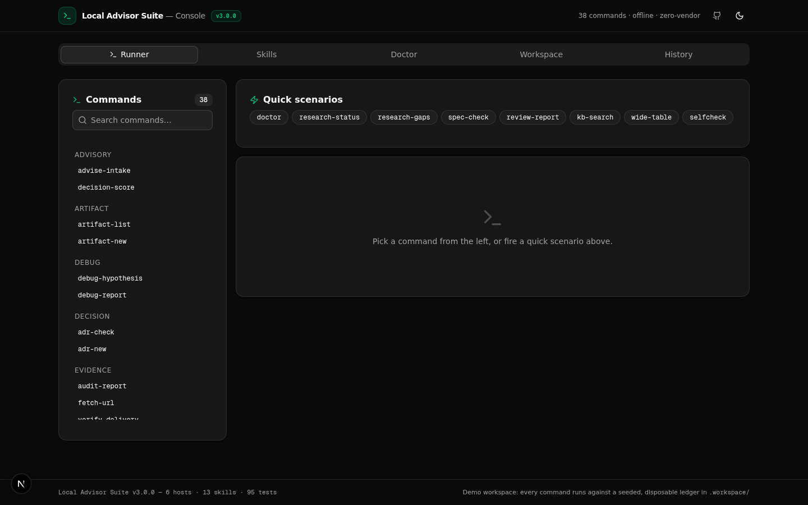

# Local Advisor Suite — Console

**v3.0.0** · cross-host agent skill suite + a web console to drive every command from your browser.

This repository contains two things:

| Path | What it is |
| --- | --- |
| `suite/` | **Local Advisor Suite v3.0.0** — the offline, vendor-neutral workbench: 38 commands, 13 skills, 95 tests, installer for 6 hosts (Claude Code, Codex, ZCode, Cursor, OpenCode, generic AGENTS.md) |
| root | **Web Console** — a Next.js 16 app that runs every workbench command against a seeded demo workspace, no setup required |



## Why a console?

The suite is a CLI (`suite/workbench.py`) designed to be driven by coding agents. The console gives humans the same seat: pick a command, fill its real arguments, run it, and inspect the structured JSON it emits — plus a doctor dashboard, a skills browser, live workspace ledgers and a persisted run history.

Everything the console runs is **the real Python CLI**, spawned server-side with:

- an **allowlist** derived from the CLI's own argparse tree (unknown commands are rejected with HTTP 400),
- a **pinned `--state-dir`** (user-supplied overrides are stripped) so runs stay inside the demo workspace,
- a hard **45 s timeout** and captured stdout/stderr,
- a **seeded workspace** (`.workspace/`, gitignored) with a 6-host install, research/spec/review/knowledge/debug ledgers, an ADR, an artifact and a handoff pack — resettable with one click.

## Quick start (console)

```bash
bun install                 # or: npm install
cp .env.example .env        # SQLite via Prisma
bun run db:push             # create the run-history database
bun run dev                 # http://localhost:3000
```

Requirements: Node.js / Bun, Python 3.9+ on PATH. The first page load introspects the CLI and caches the command catalog.

On first run the workspace is empty — open the **Workspace** tab and hit **Reset workspace** (seeds demo state, ~10 s), or run any command; read-only ones work against whatever state exists.

## Quick start (suite)

```bash
cd suite
./run_tests.sh                          # 95 tests, zero dependencies
python3 install.py --project ~/myapp    # installs skills for 6 hosts
python3 workbench.py doctor             # installation health check
```

See `suite/README.md` for the full suite documentation, and `suite/CHANGELOG.md` for what changed in v3.0.0.

## Console tour

| Tab | What you can do |
| --- | --- |
| **Runner** | Search all 38 commands by category, fill auto-generated argument forms (repeatable flags, switches, choice dropdowns), add raw extra args, run and inspect JSON output with status/exit/duration |
| **Skills** | Browse the 13 bundled skills, read each `SKILL.md` rendered as markdown, and open the bundled `examples/*.md` walkthroughs in per-skill tabs |
| **Doctor** | One-click `doctor` (host detection, per-check health table) and `selfcheck` (vendor-neutrality scan over the whole suite) |
| **Workspace** | Inspect the seeded ledgers (research, spec, review, kb, debug, advisory), generated artifacts, and reset everything |
| **History** | Every run persisted in SQLite — expand any row to replay its JSON output |

**Example scenarios** cover all 38 commands — one click fills the form with working arguments and runs the command against the seeded workspace. They are grouped (Suite health, Research, Spec, Review & evidence, Knowledge, Advice & decisions, Debug, Artifacts, Handoff, Scope); amber chips (e.g. `research-init`, `spec-new`, `review-init`) wipe their ledger first, and the demo data can be restored anytime with *Reset workspace*.

Every scenario argv is validated end-to-end by `scripts/test_scenarios.py` (fresh seeded workspace, expected statuses and exit codes), and the UI chips are generated from the same `scripts/scenarios.json` via `scripts/gen_scenarios_ts.py` — UI and tests can never drift apart.

## Repository layout

```
├── suite/                    # Local Advisor Suite v3.0.0 (self-contained)
│   ├── workbench.py          # 38-command CLI (JSON in, JSON out)
│   ├── install.py            # 6-host installer / uninstaller
│   ├── skills/               # 13 skills with references/templates/examples
│   ├── tests/                # 95 tests (run_tests.sh)
│   └── references/ templates/ tools/
├── src/
│   ├── app/                  # Next.js app router (single page + API routes)
│   │   └── api/              # /catalog /run /skills /workspace /history
│   ├── components/console/   # Runner, SkillsBrowser, DoctorPanel, WorkspacePanel, HistoryPanel
│   └── lib/suite.ts          # spawn/isolation layer between web and CLI
├── scripts/
│   ├── introspect_catalog.py # argparse → JSON command catalog
│   ├── seed_workspace.py     # demo workspace seeder (also used by "Reset")
│   ├── scenarios.json        # single source of truth for the 38 example scenarios
│   ├── test_scenarios.py     # validates every scenario against a fresh seed
│   └── gen_scenarios_ts.py   # scenarios.json → src/lib/scenarios.ts
├── prisma/schema.prisma      # RunLog model (run history)
└── .env.example
```

## Notes

- The console never modifies `suite/` — the suite stays a pristine, agent-consumable package; all runtime state lives in `.workspace/` (gitignored).
- Run history is best-effort: if the database is unavailable the console still executes commands.
- To point the console at a different suite checkout: `SUITE_DIR=/path/to/suite bun run dev`.

## License

MIT — see `suite/LICENSE`.
